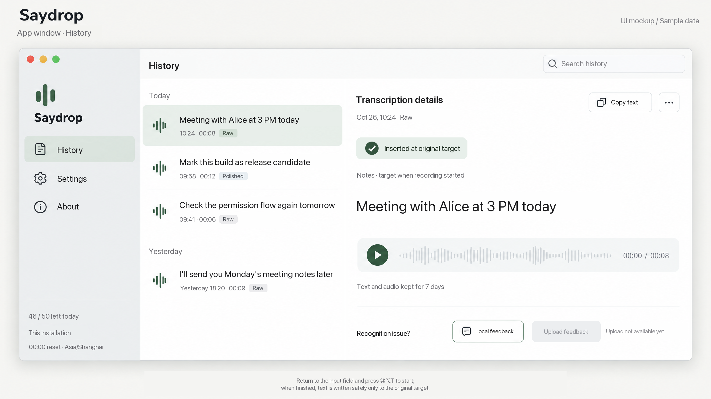

# Saydrop

Saydrop is a macOS menu bar app that turns speech into text. Press a global shortcut, speak, and the recording is sent to a self-hosted transcription backend. The result is inserted into the text field you started from, or shown in a preview you can copy from.

This repository contains the native macOS client, the FastAPI backend, tests, product notes, and design assets. It is a **development project** — there is no signed, notarized, or publicly installable build here.



## What it does

- **Menu bar voice input** — lives in the menu bar, records from the microphone, and is driven by a configurable global shortcut (default **⌘⌥T**).
- **Cloud transcription** — sends the in-memory WAV to your own backend, which calls a speech-to-text provider. Raw transcription and a light text-polish mode are available.
- **Write-back or preview** — after checking the target app, window, input field, and selection, Saydrop replaces the selection or inserts at the cursor via macOS Accessibility, then reads the text back to verify. When insertion is not safe or supported, the result stays in a preview for manual copy.
- **Local recording check** — a microphone and shortcut check that never uploads audio.
- **Encrypted local history** — optionally keeps transcripts and recordings in an AES-256-GCM encrypted archive; the key lives in Keychain.
- **Self-hosted backend** — FastAPI, SQLite, single worker. Provider keys stay on the server; the client never holds them.

### How it fits together

```text
┌──────────────────────────┐        HTTPS (loopback in Debug)        ┌─────────────────────────┐
│  Saydrop.app (macOS)     │ ──────────────────────────────────────▶ │  Saydrop backend        │
│  SwiftUI / AppKit        │   POST /v1/transcriptions (audio/wav)   │  FastAPI + SQLite       │
│  shortcut → mic → WAV    │ ◀────────────────────────────────────── │  quota, budget, limits  │
│  Accessibility write-back│          ready / failed / cancelled     └───────────┬─────────────┘
└──────────────────────────┘                                                     │
                                                                       ┌──────────▼──────────┐
                                                                       │ OpenRouter or Groq  │
                                                                       │ STT (+ polish)      │
                                                                       └─────────────────────┘
```

The backend stores authentication, quota, task metadata, and anonymous numeric metrics — not audio or transcript bodies. Recognition is not offline: audio is processed by the selected external provider.

## Requirements

| Component | Requirement |
| --- | --- |
| Mac app | Apple Silicon Mac, macOS 14+, Xcode with the macOS SDK |
| Backend | Python 3.12+ (tested on 3.13), [`uv`](https://docs.astral.sh/uv/) |
| Cloud transcription | An OpenRouter or Groq account and API key |

The app has been built and tested in **Debug** on Apple Silicon. Cross-version macOS behavior, signing, notarization, and production deployment are not verified.

## Quick start

### 1. Start the backend

From the repository root:

```bash
# Install the backend and its locked dependencies into server/.venv
uv sync --project server --locked

# Create the local environment file
cp server/.env.example server/.env
chmod 600 server/.env

# Generate the two independent server secrets (run each separately)
python3 -c "import secrets; print(secrets.token_hex(32))"     # SAYDROP_TOKEN_PEPPER
python3 -c "import secrets; print(secrets.token_hex(32))"     # SAYDROP_FINGERPRINT_KEY
```

Edit `server/.env` and fill in:

1. `SAYDROP_TOKEN_PEPPER` and `SAYDROP_FINGERPRINT_KEY` with the generated values.
2. A provider mode and key — see [Provider configuration](#provider-configuration).
3. Budget values — cloud tasks are rejected with `503 budget_unavailable` until the daily budget and both worst-case estimates are positive and the config version is set.

Then create the database and start the single-worker server:

```bash
cd server

# Explicit migration (safe to re-run; also required after upgrading)
.venv/bin/python -m saydrop_server.migrate

# Run the API on loopback
.venv/bin/uvicorn saydrop_server.main:create_app \
  --factory --host 127.0.0.1 --port 8000 --workers 1 \
  --no-access-log --no-proxy-headers
```

Verify it is up:

```bash
curl http://127.0.0.1:8000/healthz
```

Notes:

- The server loads `server/.env` at startup; environment variables of the same name override it.
- Run exactly **one worker**. SQLite plus a process lock rejects a second business process.
- `SAYDROP_ENVIRONMENT=development` with `SAYDROP_ALLOW_LOOPBACK_HTTP=true` permits plain HTTP from loopback only. Anything else requires HTTPS.
- The database is `server/data/saydrop.sqlite3` by default.

### 2. Build and run the macOS app

1. Open `apps/macos/Saydrop.xcodeproj` in Xcode.
2. Select the **Saydrop** scheme and the **Debug** configuration.
3. Build and run. Xcode resolves the pinned Swift package dependencies.
4. The app is a menu-bar app (`LSUIElement`), so look for the Saydrop icon in the menu bar rather than the Dock.

Debug is preconfigured for local development:

- Bundle ID `local.saydrop.dev`
- Backend URL `http://127.0.0.1:8000`
- Local cloud-processing disclosure text, and `NSAllowsLocalNetworking` for loopback HTTP

The Release configuration has an empty bundle ID and backend URL and does not include disclosure text, so it cannot upload until you fill those in (see [App configuration](#app-configuration)).

You can also build from the command line without opening Xcode:

```bash
bash apps/macos/scripts/check-cloud.sh --build
# app: .work/build-cache/xcode-build/Build/Products/Debug/Saydrop.app
```

### 3. First run in the app

1. Complete the first-run introduction.
2. Grant **Microphone** access when prompted. For the no-upload test, open **Settings → Local recording check**, enable the local-check purpose, and record — audio stays in memory and is never sent.
3. To use cloud transcription, open **Settings → Cloud recognition**, read the disclosure, and accept it. This is the only action that checks the backend health, registers an anonymous installation if needed, stores its credential in Keychain, and fetches the quota.
4. To write results directly into other apps, grant Saydrop **Accessibility** permission in **System Settings → Privacy & Security → Accessibility**. Optional: grant **Input Monitoring** if you want the global Esc key to cancel recording.
5. Put the cursor in the target text field, press **⌘⌥T**, speak, and press the shortcut again to stop. The transcript is inserted and verified, or shown in the preview for copying.

Settings lets you change the shortcut, choose toggle vs push-to-talk, select raw or light-polish output, and enable recording/transcript history. History is stored locally in an encrypted archive under `~/Library/Application Support/local.saydrop.dev/`.

## Provider configuration

Set these in `server/.env`:

### OpenRouter (default)

```dotenv
SAYDROP_PROVIDER_MODE=openrouter
SAYDROP_STT_MODEL=elevenlabs/scribe-v2            # or openai/whisper-large-v3-turbo
SAYDROP_POLISH_MODEL=openai/gpt-4.1-mini
OPENROUTER_API_KEY=your-key
```

Light polish runs through OpenRouter. If the polish result fails validation or upstream, the backend falls back to the raw transcript.

### Groq

```dotenv
SAYDROP_PROVIDER_MODE=groq
SAYDROP_STT_MODEL=whisper-large-v3-turbo          # or whisper-large-v3
GROQ_API_KEY=your-key
```

Groq handles speech-to-text only. Light-polish requests return the raw transcript marked `failed_fallback_raw`; no OpenRouter call is made. An optional loopback-only proxy can be configured with `SAYDROP_GROQ_PROXY_URL=http://127.0.0.1:7890`.

### Local mock (development only)

```dotenv
SAYDROP_ENVIRONMENT=development
SAYDROP_PROVIDER_MODE=mock
SAYDROP_DAILY_BUDGET_UNITS=1000
SAYDROP_RAW_ESTIMATE_UNITS=1
SAYDROP_POLISH_ESTIMATE_UNITS=2
SAYDROP_BUDGET_CONFIG_VERSION=local-mock-v1
```

Mock mode returns text prefixed with `[MOCK]`, makes no vendor calls, and requires no API key. It is rejected outside `SAYDROP_ENVIRONMENT=development`.

### Budget values

| Variable | Meaning |
| --- | --- |
| `SAYDROP_DAILY_BUDGET_UNITS` | Daily integer billing-unit limit |
| `SAYDROP_RAW_ESTIMATE_UNITS` | Worst-case cost estimate for a 120-second raw transcription |
| `SAYDROP_POLISH_ESTIMATE_UNITS` | Worst-case cost estimate for transcription plus one polish |
| `SAYDROP_BUDGET_CONFIG_VERSION` | Reviewed configuration version label |

Units are operator-defined abstract billing units, not USD. Do not guess prices; choose values you have reviewed for your provider account. The ledger is a preflight guard, not a hard cap on the provider bill — also set a hard limit in the provider dashboard.

## Configuration reference

### Backend environment (`server/.env`)

| Variable | Default | Purpose |
| --- | --- | --- |
| `SAYDROP_ENVIRONMENT` | `development` | `development` (loopback HTTP and mock allowed) or production |
| `SAYDROP_ALLOW_LOOPBACK_HTTP` | `false` | Allow plain HTTP from loopback in development |
| `SAYDROP_PROVIDER_MODE` | `openrouter` | `openrouter`, `groq`, or `mock` |
| `SAYDROP_STT_MODEL` | `elevenlabs/scribe-v2` | Allowlisted model matching the provider |
| `SAYDROP_POLISH_MODEL` | `openai/gpt-4.1-mini` | Fixed polish model |
| `OPENROUTER_API_KEY` / `GROQ_API_KEY` | empty | Provider credentials; server-side only |
| `SAYDROP_TOKEN_PEPPER` | required | ≥32 chars; hashes anonymous installation tokens |
| `SAYDROP_FINGERPRINT_KEY` | required | ≥32 chars; HMACs audio fingerprints |
| `SAYDROP_TOKEN_KEY_VERSION` | `v1` | Key version recorded with hashes |
| `SAYDROP_METRICS_TOKEN` | empty | 43-char base64url token for `GET /internal/metrics`; when empty the endpoint fails closed |
| `SAYDROP_METRICS_RETENTION_DAYS` | `30` | Numeric metrics retention |
| `SAYDROP_GROQ_PROXY_URL` | empty | Optional explicit loopback HTTP(S) proxy for Groq |

Fixed runtime limits (60 s task deadline, 120 s audio, 8 MiB WAV, 16 kHz mono PCM16, 50 tasks/day/installation, 4 concurrent tasks) are defined in `server/saydrop_server/config.py`.

### App configuration

The Debug build reads `apps/macos/SaydropApp/Info-Debug.plist`; Release reads `Info.plist`. Two things must be configured before cloud upload works:

1. **Backend URL** — the `SAYDROP_BACKEND_URL` build setting, injected as `SaydropBackendURL`. Debug points at `http://127.0.0.1:8000`; Release is empty.
2. **Disclosure keys** — `SaydropCloudDisclosureVersion`, `SaydropCloudReceiver`, `SaydropCloudPurpose`, and `SaydropCloudRetention`. If any is empty, the cloud recording entry stays closed. `CloudDisclosure.example.plist` is an empty template that is **not** loaded automatically; copy reviewed values into the app's plist.

Changing the disclosure version or text invalidates previously stored consent, which the user must accept again.

## Run checks

From the repository root:

```bash
# Swift package tests (Core, Realtime, UI) and an optional Debug build
bash apps/macos/scripts/check-cloud.sh --snapshots --build

# Backend tests and lint
uv sync --project server --extra test --locked
cd server
.venv/bin/python -m pytest -q
.venv/bin/python -m ruff check saydrop_server tests
```

These tests use mocks, synthetic audio, and a mock HTTP transport. They do not prove real provider quality, real microphone capture, or cross-app insertion on your Mac.

## API overview

Business endpoints (JSON is camelCase; responses are `Cache-Control: no-store`):

```text
GET    /healthz
POST   /v1/installations
GET    /v1/quota
POST   /v1/transcriptions                 # raw WAV body + Idempotency-Key
GET    /v1/transcriptions/{requestId}
DELETE /v1/transcriptions/{requestId}
```

Independent operations endpoint, authenticated with `SAYDROP_METRICS_TOKEN`:

```text
GET /internal/metrics?days=1&source=live|mock|offline
```

`/docs`, `/redoc`, and `/openapi.json` are intentionally not exposed.

## Repository guide

| Path | Contents |
| --- | --- |
| `apps/macos/` | SwiftUI/AppKit menu bar app, Xcode project, UI tests, local Swift/C packages |
| `apps/macos/packages/SaydropCore` | Core audio and session logic |
| `apps/macos/packages/SaydropRealtime` | Bounded real-time audio ring/resampling |
| `server/` | FastAPI backend, SQL migrations, backend tests |
| `specs/` | Product requirements and technical specification |
| `assets/` | Screenshots, icon assets, UI interaction guide |

More detail: [macOS app guide](apps/macos/README.md) · [backend guide](server/README.md) · [product specification](specs/product-requirements.md) · [technical specification](specs/technical-specification.md).

## Status and limitations

- Development-only: no code signing, notarization, DMG release, or public install path.
- Automatic insertion supports standard Accessibility text fields; password fields, secure input, read-only fields, multi-selection, and editors without Accessibility support fall back to copy-from-preview.
- Recognition quality, provider retention/training policies, and cross-provider behavior have not been independently verified.
- Local history is encrypted, but physical zeroization of RAM, swap, or backups cannot be guaranteed.
- Do not commit `server/.env`, `server/data/`, build output, or any provider key.
