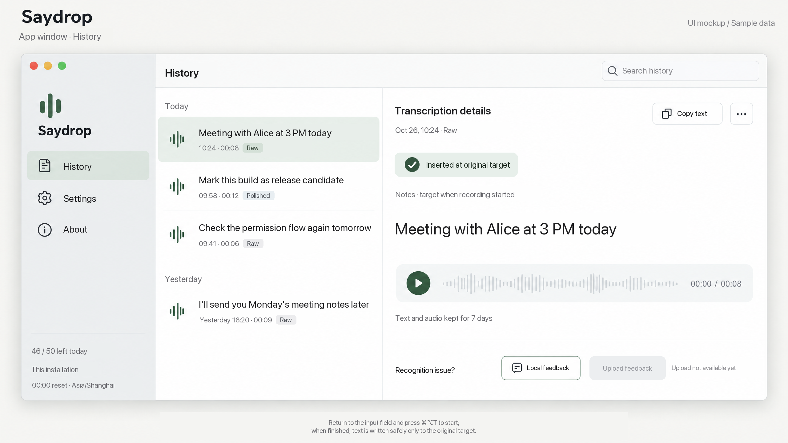
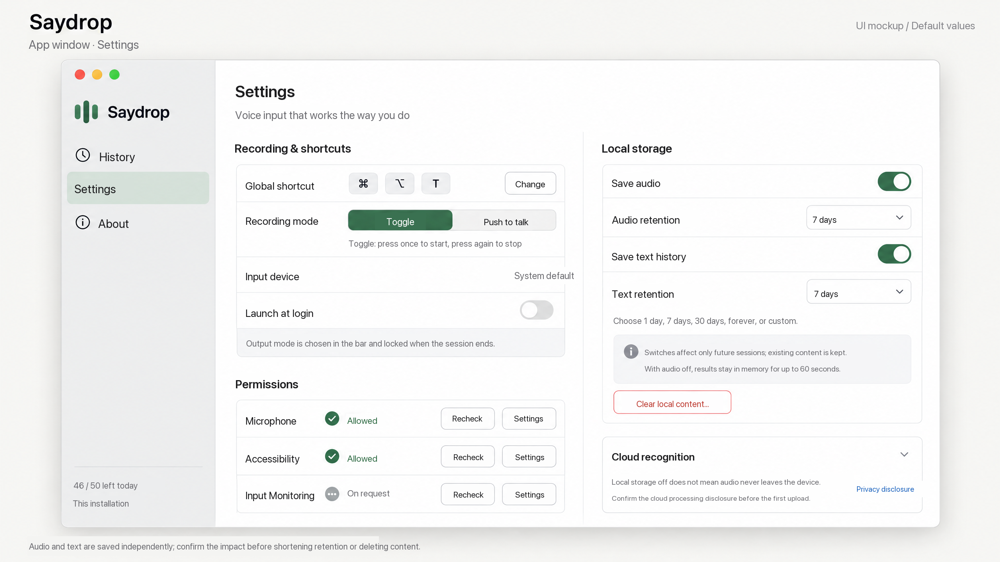
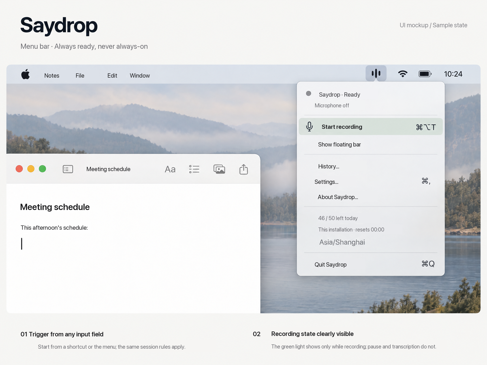
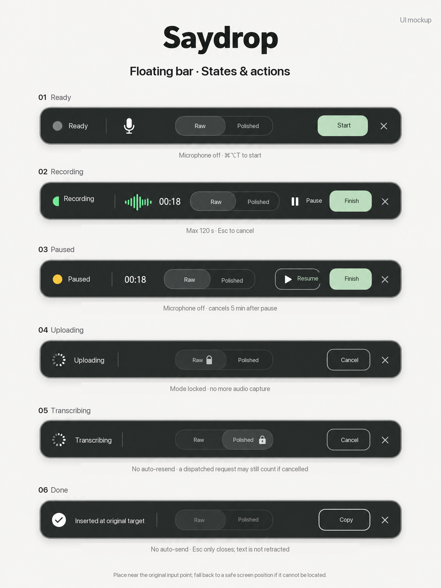
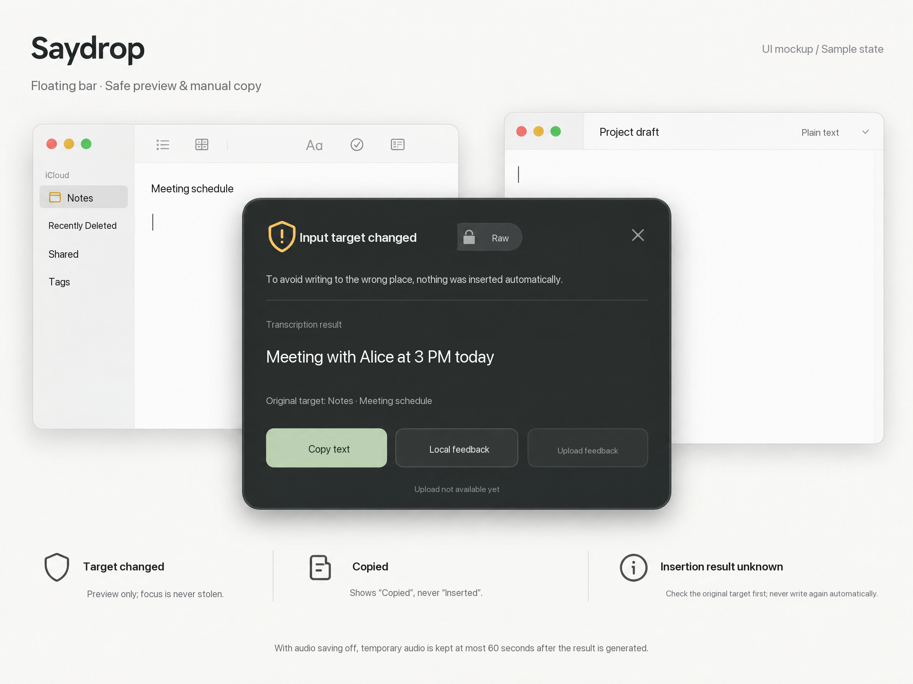

# Saydrop UI Interaction Guide

The light app window is for reviewing history and changing settings, the menu bar provides quick access, and the dark floating bar handles the current voice input session. The interface stays out of the way of the app the user is editing. Audio is captured only when the user starts a session.

**Deliverables:** Five high fidelity static design images and this guide. The history, quota, permissions, and results shown in the images are design examples, not screenshots of a running app.

## 1. Interface overview

### App window: history and details

The main window has three columns: navigation sidebar, history list, and transcription details. It opens on history by default. It does not show login, purchases, model selection, or a statistics dashboard. The sidebar contains only History, Settings, and About; quota is secondary information.

History is grouped by date. Each item shows a content summary, creation time, recording duration, and output mode. Selecting an item shows the result and any available recording on the right. “Copy text” appears at the top of the details, followed by playback, feedback, and retention information. Search covers only saved local text history, not the contents of external input fields.

“Inserted at the original input position” appears only when a successful write can be confirmed. The app that was targeted when recording began is identified below it. History details do not offer “insert again automatically” or “polish again,” which could overwrite content being edited elsewhere. Both audio and text saving are enabled in the illustration, so text details and playback are available.

The main window does not have a large record button that could mistake the history page for the input target. The user returns to the app where they want to type and presses **⌘⌥T**; the menu bar also offers an entry point. Closing the main window closes only that window. Saydrop remains idle with the microphone off; Quit is in the menu.

When history is empty, show: “No history yet. Return to an input field and press ⌘⌥T to begin.” When both audio and text history are off, show: “Local history is off. You can still preview and copy the current result.” Do not imply that unsaved content can be reviewed later.

### App window: settings

Settings has four groups: Recording and Shortcut, Permissions, Local Storage, and Cloud Processing. This keeps the page from becoming one long list of unrelated controls.

The default shortcut is ⌘⌥T. “Change” enters shortcut recording and checks for conflicts. Recording defaults to “Press to toggle”; “Hold to talk” is the other option. The input device is shown as “System default”; device switching is outside this release. Launch at login is off by default.

Output mode has no separate switch in Settings or the menu. The user chooses it manually in the floating bar. The first session uses Raw; later sessions remember the last manual choice. This does not change the recording method.

“Save audio” and “Save text history” have independent switches and retention periods. Both start on with a seven day period. Options are 1 day, 7 days, 30 days, Forever, and Custom. Custom accepts a positive integer from 1 to 3,650 days; show an inline error and do not save an invalid value.

Turning off a switch affects only future sessions and does not delete existing content. If shortening a period affects existing records, first show the number and content types affected, then ask for confirmation. “Clear existing local content…” opens a local confirmation; changing a switch cannot stand in for deletion confirmation.

The Permissions group shows separately checked results. When a permission is missing, offer “System Settings” and “Check again.” Without Accessibility permission, transcription remains available, but the result must be previewed and copied manually. Request Input Monitoring only if the chosen shortcut or Esc implementation actually requires it, not on first launch by default. “Allowed” in the design is an example; the client must display actual system results.

### Menu bar: status menu

The menu bar uses a monochrome sound wave concept icon. Clicking it opens a compact grouped menu, not a large dashboard. It shows Saydrop and its current state at the top, followed by Start Recording, Show Floating Bar, History, Settings, About, and Quit.

Idle shows a gray state and “Microphone off.” Recording shows a green capture state and “Recording.” Paused, uploading, and transcribing use descriptions that do not imply recording. Each state must include text as well as color.

“Start Recording” and the shortcut use the same session logic. When recording actually starts, capture the original input target and check prerequisites. Do not treat the menu, history page, or whichever field has focus later as the insertion target. If a writable target cannot be determined, do not promise automatic insertion; show a preview when processing finishes.

During an active session, the main menu action becomes “End Recording” or “Resume Recording” according to state. Starting is disabled during upload and transcription, with a “Processing” state. The menu must not create a concurrent session. The shortcut remains a system level entry point even when macOS hides the menu bar icon.

Quota shows “N / 50 remaining today,” “This installation,” and the next reset time. The illustrated 46 / 50 is only an example. The client must use the server's authoritative value and show the **Asia/Shanghai** time zone. If the quota lookup fails, show “Quota temporarily unavailable,” not a stale number presented as current.

### Floating bar: core states

Place the floating bar near the original input point when possible without covering the text. If a reliable position is unavailable, use a fixed safe position on the target's display and keep it within screen bounds. A nonactivating panel is the design direction, but it cannot be assumed never to affect focus: revalidate the original target before every automatic write.

The user may choose Raw or Light Polish manually while idle, recording, or paused. Lock the mode when recording ends. Upload and transcription show the locked choice and do not allow changes to the current processing path. A completed item's mode must not trigger another automatic rewrite.

**Idle.** Gray state; microphone off. “Start” or the shortcut first checks microphone permission, network, quota, and session prerequisites. If something is missing, explain why before starting recording.

**Recording.** Only this state shows the green recording indicator, “Recording,” and a live waveform. The timer shows cumulative captured time. “Pause” stops capture; “End” begins finalization. At 120 seconds of cumulative capture, end automatically and show “120 second limit reached. Processing this recording.” Do not split it into multiple requests.

**Paused.** Amber state, “Paused,” and a frozen capture timer; no live waveform or green recording indicator. The user can resume, end, or cancel. Also show the remaining pause time. Cancel automatically after a single five minute pause, without uploading.

**Finalizing and uploading.** Show “Preparing audio,” then “Uploading.” The microphone is off, the mode is locked, and only Cancel remains. Do not show a precise percentage if it cannot be measured.

**Transcribing.** Use a neutral progress indicator and “Transcribing.” If Light Polish was chosen and recognition has finished, change the stage label to “Lightly polishing,” without showing a recording state. Cancel is best effort: a request that may already have been dispatched cannot be promised as withdrawn or refunded. Do not resend audio automatically.

**Complete.** Show “Inserted at the original input position” only after the write is confirmed. Keep Copy and Close available. Do not send a message or press Enter automatically. After completion, Esc closes the floating bar; it does not undo text or delete history.

The floating bar's × means Cancel before a session completes, with the tooltip “Cancel · Esc.” Once complete, it means Close, with the tooltip “Close.” If the user cancels after upload, explain that a dispatched request may still count against quota. Do not say “Upload withdrawn.”

### Floating bar: safe result preview

If the input target changes, permission is revoked, secure input is active, or the writable range is unclear, do not write to the newly focused field. Expand the floating bar into a result preview showing the specific reason, text, and original target. Offer “Copy text” and Close without stealing focus from the target app.

The target change message in the design is: “The input target changed. To avoid writing in the wrong place, this result was not inserted automatically.” Other blocking reasons need their own explanations; do not label them all as network errors.

After copying, briefly show “Copied,” then return to “Copy text.” **A successful copy is not a successful insertion.** If the text can be previewed, the user can copy it manually without consuming another transcription.

If a paste was sent but its outcome cannot be confirmed, show “Insertion result unknown” and “Check the original input position before pasting again.” Keep the preview, stop all automatic writes, and provide neither an “Automatically retry insertion” button nor another write strategy as a repair attempt.

## 2. Four key flows

### Shortcut input

The user places the cursor in an input field in the target app and presses ⌘⌥T. Saydrop checks prerequisites, captures the original target, starts recording, and shows the floating bar. The user can pause or manually select Light Polish. Pressing the shortcut again or clicking “End” locks the mode and stops capture. Finalization, upload, and transcription follow. If the original target and range still pass safety checks, write only there using normal text input semantics. Show completion after a confirmed write; do not press Enter automatically.

In Hold to Talk mode, key down starts and key up ends. When paused, key down resumes and key up ends. Key repeat must not create multiple sessions or requests. Start, Pause, and End on the floating bar retain the actions described by their labels.

### Target change and unknown outcomes

The user switches to another window or input field after recording. When the result arrives, Saydrop finds that the original target is no longer safe and shows a preview. The user copies the result and chooses where to paste it. The interface must not guess which new window should receive it.

Automatic writing can only move down this sequence: safe direct insertion → provably safe paste → preview and copy. Stop immediately after confirmed success or an unknown outcome. Continue to the next step only when the previous strategy is known not to have written anything. Never replace the entire contents of the target control.

### Cancellation and interruption

During recording, pause, upload, transcription, or a preview that has not been inserted, Esc or Cancel ends the session, ignores late results, and neither creates history nor continues writing. Canceling a recording is not pausing it; the next start creates a new session.

Screen lock, sleep, device loss, and an unrecoverable permission change end the current session. On return, show a clear reason and do not resume the old recording. A cancellation or failure after possible supplier dispatch may count against quota. Say “Does not count” only if the system can prove the request was not dispatched.

### History, retention, and deletion

The user selects a history item and can copy text, play an available recording, or open local feedback on the right. Viewing, playback, copying, and feedback do not extend expiration. Deleting one item requires confirmation through the details menu; clearing everything requires confirmation in Settings. The deletion explanation must not promise physical erasure from an SSD, backup, or system snapshot.

When audio saving is on and text saving is off, show only audio and metadata without transcript content. Do not show a transcript summary or save user corrected text. When audio is off and text is on, keep the text; audio exists only in an in memory buffer for at most 60 seconds after the result is available. When both are off, do not create reviewable history.

## 3. First use and privacy disclosure

Onboarding introduces local storage, microphone permission, Accessibility permission, and cloud processing before the first actual upload. Input Monitoring is requested conditionally, not as a mandatory step. Both default local saving switches must be visible during onboarding, not hidden inside collapsed privacy text.

The cloud disclosure must say at least this: audio is sent via HTTPS to the product backend, which forwards it to the recognition provider for that request. Turning off local storage does not keep audio on the device. Disclose the actual provider and purpose; do not present a candidate model in the documentation as a confirmed production provider. The backend keeps result text in memory briefly, for no more than 120 seconds, and retrieving it does not extend that period. Do not make promises about the provider's retention policy on its behalf.

Explain that no login is needed but an anonymous installation credential is used, and quota is counted per installation rather than per person. Do not use a hardware serial number or hidden fingerprint. If the user does not continue or closes the disclosure, stay idle without recording, uploading audio, or silently changing the processing path.

If Accessibility is denied, transcription and copying can still be used when microphone and network requirements are met. Show “Automatic insertion unavailable”; do not suggest that automatic writing is ready.

## 4. Error and fallback copy

**Microphone permission missing:** “Allow microphone access before recording.” Actions: System Settings and Check again.

**Accessibility unavailable:** “You can transcribe and copy; automatic insertion is unavailable.” Safe copy mode remains available.

**Today's quota exhausted:** “0 / 50 remaining today.” Show the server's next reset time and time zone. Disable Start; history and copying remain available. Do not show an upgrade purchase action.

**Network unavailable:** “Cannot connect right now. Restore your connection and try again.” Do not capture audio if a session has not started. If a request was submitted, check that request's status first; do not treat a lost acknowledgement as an upload failure and resend immediately.

**Service temporarily unavailable:** “Transcription is temporarily unavailable. Try again later.” Do not secretly switch providers or promise success or a quota refund.

**Light Polish failed:** “Light Polish is unavailable; the raw transcript is preserved.” Show the raw text and label the fallback. Do not call polishing a second time or use another transcription credit.

**Request result unknown:** “The result of this request cannot be confirmed yet.” Prefer “Check original request status”; do not upload old audio automatically. If the user can explicitly start a new attempt, first explain that it may count as a new transcription. If the available audio has expired, the user must record again.

**Result expired:** “This result has expired and cannot be recovered from the server.” Offer recording again; do not pretend to restore old text. Locally saved text protected by the retention policy can still be viewed, but that is not a successful server recovery.

**Temporary recording cleared:** “Temporary recording cleared.” Disable playback and remove prepared audio feedback. Available text remains subject to its own retention policy.

## 5. Local feedback

“Local feedback” in previews and history opens a lightweight issue description. The user can choose a recognition problem, enter a reason and corrected text, and play the audio while it is still available. Save only content permitted by the corresponding enabled history types; feedback must not bypass disabled text or audio saving.

When audio saving is off, start an in memory countdown of at most 60 seconds when the final result can be shown or a retryable failure occurs. Previews and feedback can show “Temporary recording will be cleared in N seconds.” Opening a page, playing audio, giving feedback, or losing connectivity never extends the timer. Stop playback immediately on expiration and do not save another copy of the audio.

## 6. Visual and component guidance

The visual direction is warm white, graphite, and sage green. Suggested colors: main background `#F5F5F2`, body text `#242A29`, selection background `#DDE8E0`, primary action `#315C48`. Use a dark graphite material for the floating bar. Recording needs a distinct clear green indicator; pause and safety blocks use amber. Neutral processing must not show the recording green light. A green Settings toggle means an option is on, not that the microphone is capturing.

Use system fonts in the final implementation, including system fallback for Chinese. Suggested window body text is 13–14 pt and group headings 16–18 pt; panel actions need adequate click targets. Suggested main window size is 1080 × 720 pt initially, with a minimum of 860 × 600 pt. At narrower widths, turn history details into two column navigation instead of squeezing important copy. Suggested floating bar size is 560–640 pt wide and 56–64 pt high; the preview panel is about 520–560 pt wide. Adapt actual dimensions to text and accessibility settings. These are design suggestions, not changes to product defaults.

Use 8 pt as a common spacing unit and 16–24 pt padding in content areas. Separate columns and groups with thin lines rather than heavy cards. Use standard system window controls. The sound wave mark is a concept icon; no final logo or trademark has been approved.

Give every button a clear name, provide text states as well as color, and make keyboard focus visible. State changes must be readable to Accessibility users; the waveform is not the only recording signal. Respect Reduce Motion and avoid flashing or overly strong glass effects. The images are visual concepts; precise behavior and copy follow this guide and the confirmed baseline.

## 7. Relationship to project specifications

This guide draws on the root [`AGENT.md`](../AGENT.md), [product specification](../specs/product-requirements.md), and [technical specification](../specs/technical-specification.md). The defaults summarized in `AGENT.md` are toggle recording by default, no launch at login, Raw for the first session, independent audio and text saving with seven days for each, and 50 transcriptions per installation per day.

No product difference requiring a new user decision was found in this design pass. Window sizes, colors, component spacing, column layout, and menu organization are UI recommendations; they do not add another platform, model, account, or subscription. Saydrop is a native macOS app. These static designs do not imply a web client.

## 8. Design references

The menu bar design uses a native grouped menu and short commands, following Apple's menu first guidance for menu bar extras.[1] The app window uses standard window controls and columns rather than a custom window frame.[2] The references were reviewed; the final UI images are newly generated concepts and do not directly use third party image assets.

[1]: https://developer.apple.com/design/human-interface-guidelines/the-menu-bar "Apple Human Interface Guidelines — The menu bar"
[2]: https://developer.apple.com/design/human-interface-guidelines/windows "Apple Human Interface Guidelines — Windows"
